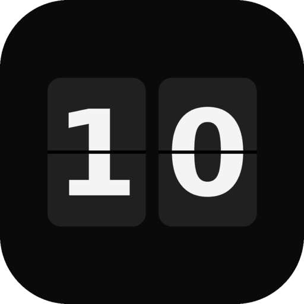

<p align="center">
  
</p>

<h1 align="center">Tock</h1>

<p align="center">
  
</p>

<p align="center">
  <b>A flip clock screensaver for Linux.</b><br>
  Big flip-card digits, a real turning animation, and a screensaver that starts on every monitor when you go idle.
</p>

<p align="center">
  <a href="LICENSE"></a>
  <a href="#compatibility"></a>
  <a href="https://github.com/Umbra-Domini/tock-linux/releases"></a>
  <a href="https://buymeacoffee.com/umbradomini"></a>
</p>

<p align="center">
  <a href="https://tock-linux.netlify.app">Website</a> ·
  <a href="https://github.com/Umbra-Domini/tock-linux/releases">Download</a> ·
  <a href="https://github.com/Umbra-Domini/tock-linux/issues">Report a bug</a>
</p>

---

## Contents

- [About](#about)
- [Features](#features)
- [Install](#install)
- [Quick start](#quick-start)
- [Settings reference](#settings-reference)
- [How the screensaver works](#how-the-screensaver-works)
- [Compatibility](#compatibility)
- [Troubleshooting](#troubleshooting)
- [Files and uninstalling](#files-and-uninstalling)
- [Development](#development)
- [Contributing](#contributing)
- [Support](#support)
- [License](#license)

## About

Tock is a flip clock for Linux, inspired by Fliqlo. Linux has no single screensaver system, so Tock brings its own: a tiny background watcher checks how long you have been idle and opens a fullscreen clock on every monitor when the time is up.

It was built and tested on GNOME (Ubuntu, Wayland). It is built with Electron and plain HTML, CSS and JavaScript, with no frameworks.

Tock is a screensaver, not a lock screen. It does not lock your session, so keep using your system's screen lock if you need one.

## Features

**Clock**

- A flip card that actually turns over, with light and shadow that follow the angle
- 12-hour or 24-hour time, with the AM/PM label in the top or bottom corner
- Card background on or off (digits only on black)
- Dim and size sliders
- Portrait layout that stacks hours above minutes on tall windows
- Burn-in shift that nudges the clock a few pixels every few minutes
- Flip sound with its own volume slider

**Screensaver**

- One fullscreen clock on every monitor
- Starts after 1 to 30 minutes of idle time
- Any key, click, scroll, touch or real mouse movement closes it
- Preview button that shows the screensaver for a few seconds, using settings you have not saved yet
- Turn off button that removes the background watcher and the login entry
- Does not start while a video player or similar app is keeping the screen awake (GNOME)

**Settings**

- Changes show live on the clock, but only count once you press **Save & set as screensaver**
- Close the app without saving and it returns to your last saved settings
- A status line shows whether the screensaver is on, off, or has unsaved changes

## Install

### From the .deb (Ubuntu, Debian and derivatives)

Download `tock_1.0.0_amd64.deb` from the [Releases page](https://github.com/Umbra-Domini/tock-linux/releases) or the [website](https://tock-linux.netlify.app), then run:

```
sudo apt install ./tock_1.0.0_amd64.deb
```

Open **Tock** from your app menu. If the icon looks generic right after installing, log out and back in once.

### From the repo

You need Node.js (22 or newer is recommended), npm and git.

```
git clone https://github.com/Umbra-Domini/tock-linux.git
cd tock-linux
npm install
npm start
```

To build your own package:

```
npm run dist             # .deb
npm run dist:rpm         # .rpm
npm run dist:appimage    # AppImage
```

The files land in `dist/`. Install the `.deb` with `sudo apt install ./dist/tock_1.0.0_amd64.deb`.

### In a browser

Open `clock/index.html` in any browser for a plain flip clock. There is no screensaver in this mode, and settings save automatically in the browser.

## Quick start

1. Open Tock from the app menu.
2. Move the mouse and click the gear icon in the top right.
3. On the **Clock** tab, set the look and sound you want.
4. On the **Screensaver** tab, set **Start after**.
5. Press **Preview** to see how it will look.
6. Press **Save & set as screensaver**.

The status line at the bottom changes to "Screensaver on" and the screensaver now starts when you are idle. You can close the Tock window. The background watcher keeps running and starts again at every login.

Handy keys: `F11` toggles fullscreen in the normal window, `Esc` closes the settings panel.

## Settings reference

| Setting | Tab | Default | Range | What it does |
|---|---|---|---|---|
| 24-hour | Clock | Off | On / Off | Shows hours as 00 to 23 instead of 12-hour with AM/PM |
| AM/PM | Clock | Top | Top / Bottom | Corner for the AM/PM label (hidden in 24-hour mode) |
| Flaps | Clock | On | On / Off | Flips digits like a card. Off swaps them instantly |
| Card background | Clock | On | On / Off | Dark card behind each digit. Off leaves digits on black |
| Burn-in shift | Clock | On | On / Off | Moves the clock up to 14 px every 3 minutes |
| Dim | Clock | 100% | 15 to 100% | Lowers brightness |
| Size | Clock | 100% | 40 to 100% | Scales the clock |
| Flip sound | Clock | Off | On / Off | Plays a click on each flip |
| Volume | Clock | 60% | 0 to 100% | Volume of the flip sound |
| Start after | Screensaver | 2 min | 1 to 30 min | Idle time before the screensaver starts |

## How the screensaver works

Tock runs in three modes, all from the same app:

| Mode | Command | What it does |
|---|---|---|
| Settings app | `tock` | The normal window with the settings panel |
| Watcher | `tock --watch` | Invisible background process that checks idle time |
| Screensaver | `tock --screensaver` | Fullscreen clock on every monitor, quits on input |

When you press **Save & set as screensaver**:

1. Your settings are written to `settings.json`.
2. A login entry is created at `~/.config/autostart/tock-screensaver.desktop`, so the watcher starts at every login.
3. The watcher is started right away, so you don't need to log out first.

The watcher checks idle time every 2 seconds. When you have been idle for the chosen delay, it launches the screensaver. When you press a key or move the mouse, the screensaver closes, and it will not start again until you have been active. When you press **Turn off**, the login entry is removed and the watcher stops by itself within a few seconds.

Other details:

- Only the main monitor plays the flip sound.
- The screensaver ignores input for its first second so it does not close itself on launch.
- The screensaver does not block your system's normal screen blanking. If the system blanks the screen first, that is your power settings at work.
- While the normal Tock window is fullscreen (used as a real clock), it keeps the display awake. A normal windowed Tock does not.
- On Wayland, apps cannot choose which monitor a window opens on. Tock runs the screensaver through XWayland so it can place one window per monitor, and falls back to the normal mode if XWayland is missing.

## Compatibility

The watcher needs a way to read your idle time, and it tries these in order:

| Desktop / session | Method | Status |
|---|---|---|
| GNOME (Wayland or X11) | Mutter idle monitor over D-Bus (`gdbus`) | Tested |
| Any X11 session | Electron's built-in idle check | Supported, less tested |
| KDE Plasma | `org.freedesktop.ScreenSaver` over D-Bus | Supported, less tested |
| Sway, Hyprland, other Wayland compositors | `swayidle` (install it separately) | Supported, less tested |

`gdbus` comes from `libglib2.0-bin`, which the `.deb` recommends and most desktops already have. If your desktop is not on this list, the watcher logs that it cannot read idle time.

Package builds are for x86_64 (`amd64`).

## Troubleshooting

**The screensaver never starts**

- Check that the status line in the app says "Screensaver on". If it says "Unsaved changes", press Save.
- Look at the watcher log:
```
  tail -n 20 ~/.config/Tock/watcher.log
```
  A line like "no way to read idle time found" means your desktop is not supported yet. See [Compatibility](#compatibility).
- Make sure the watcher is running:
```
  pgrep -af "tock.*--watch"
```
- On GNOME, a video player or anything else asking the screen to stay awake will block the screensaver on purpose. The log says so.
- Install `gdbus` if it is missing:
```
  sudo apt install libglib2.0-bin
```

**Both clocks appear on one monitor**

This is a Wayland limitation. Tock works around it with XWayland. Check that XWayland is installed (`sudo apt install xwayland`).

**There is no flip sound**

Flip sound is off by default. Turn it on in the Clock tab. In the screensaver, only the main monitor plays it.

**The screensaver starts but does not close**

Any key or real mouse movement should close it. If it does not, the watcher also closes it as soon as it sees activity. If neither works, send the end of `watcher.log` in an issue.

**Reset all settings**

Close Tock, turn the screensaver off, then:

```
rm ~/.config/Tock/settings.json
```

## Files and uninstalling

| What | Where |
|---|---|
| App | `/opt/Tock/` |
| Settings | `~/.config/Tock/settings.json` |
| Window size and position | `~/.config/Tock/window-state.json` |
| Watcher log | `~/.config/Tock/watcher.log` |
| Login entry | `~/.config/autostart/tock-screensaver.desktop` |

To remove Tock completely, press **Turn off** in the app first (this removes the login entry), then:

```
sudo apt remove tock
rm -rf ~/.config/Tock
```

## Development

```
npm install
npm start
```

| Script | What it does |
|---|---|
| `npm start` | Runs the settings app |
| `npm run watch` | Runs the idle watcher |
| `npm run screensaver` | Runs the screensaver directly |
| `npm run dist` | Builds the `.deb` |
| `npm run dist:rpm` | Builds the `.rpm` |
| `npm run dist:appimage` | Builds the AppImage |

The dev scripts pass `--no-sandbox`, which is only needed when running from the repo.

### Project layout

```
src/
  main.js       Electron main process: windows, settings file, autostart, screensaver launch
  preload.js    Safe bridge between the page and the main process (window.tock)
  watcher.js    Idle detection and screensaver start logic
clock/
  index.html    The clock page and settings panel
  script.js     Flip logic, settings, tabs, tooltips
  style.css     Layout, flip animation, settings panel
audio/          Flip sound
build/          App icon
```

A few notes for anyone reading the code:

- `watcher.js` has no Electron code in it on purpose, so it can be tested on its own.
- The screensaver only reads the saved `settings.json`. The Preview button is the one exception, and it passes unsaved settings to the preview window directly.
- The settings file is written to a temporary file and then renamed, so the watcher never reads a half-written file.
- The settings app, the watcher and the screensaver each use their own browser profile folder, so their single-instance locks never collide.

## Contributing

Bug reports and pull requests are welcome. If you are reporting that the screensaver does not start, include your desktop and session type, plus the end of `watcher.log`:

```
echo $XDG_SESSION_TYPE $XDG_CURRENT_DESKTOP
tail -n 20 ~/.config/Tock/watcher.log
```

Reports from KDE, X11 and Sway users are especially useful, since GNOME on Wayland is the setup tested so far.

## Support

Tock is free and open source. If you like it and want to say thanks, you can [buy me a coffee](https://buymeacoffee.com/umbradomini). Starring the repo and sharing it helps just as much.

<a href="https://buymeacoffee.com/umbradomini">
  
</a>

## License

[MIT](LICENSE) © 2026 UmbraDomini

Tock is not affiliated with Fliqlo.
